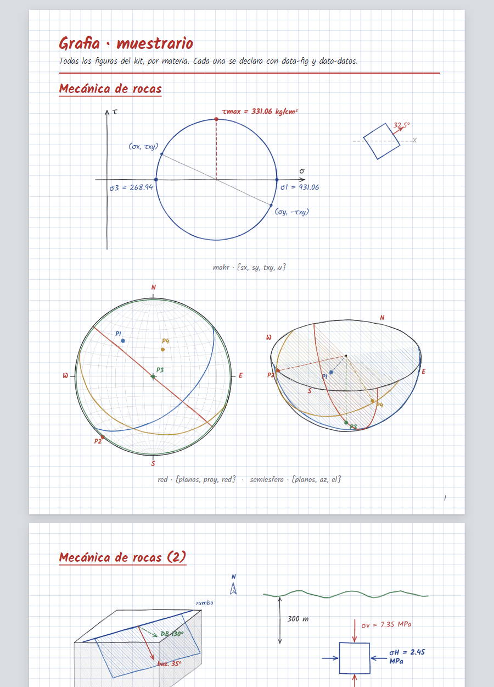

<p align="center"></p>

# Grafia

Skill de [Claude Code](https://claude.com/claude-code) para hojas que parecen **escritas y dibujadas a mano**: exámenes resueltos, solucionarios, apuntes, formularios e informes, en cuaderno cuadriculado, rayado, milimetrado o libreta. Letra manuscrita en tinta azul, títulos rojos subrayados, respuestas en recuadro y figuras con lápiz de regla y compás.

Sirve para cualquier materia; trae figuras listas para geología, minería, metalurgia y mecánica de rocas.

## Figuras incluidas

Círculo de Mohr, elemento de esfuerzos, red estereográfica y semiesfera, bloque rumbo-buzamiento, esfuerzos in situ, columna estratigráfica, corte con falla o pliegue, talud de bancos, labor con pernos, malla de perforación, diagrama de flujo de planta, curva granulométrica y barras. Cada una se declara en HTML con `data-fig` y sus datos en `data-datos`:

```html
<div class="fig" data-fig="mohr" data-w="620" data-h="280"
     data-datos='{"sx":300,"sy":900,"txy":140,"u":"kg/cm²"}'></div>
```

## Instalación

```bash
git clone https://github.com/rars2021/grafia
```

Abre Claude Code en la carpeta del repo, o copia o enlaza `.claude/skills/grafia` a `~/.claude/skills/` para tenerla en todas las sesiones. Requiere Python 3; para el PDF, Chrome o Edge.

## Uso

Pídeselo a Claude: «hazlo a mano», «como examen resuelto», «estilo cuaderno», «solucionario en PDF A4».

O a mano:

```bash
python -I .claude/skills/grafia/scripts/armar.py <fuente.html> <salida.html>   # un solo HTML, sin servidor
python -I .claude/skills/grafia/scripts/pdf.py <salida.html>                  # PDF A4 paginado
```

`ejemplos/muestrario.html` tiene todas las figuras con sus datos y sirve de prueba. Guía completa en [`SKILL.md`](.claude/skills/grafia/SKILL.md).

## Licencia

[MIT](LICENSE) © 2026 rars2021.
